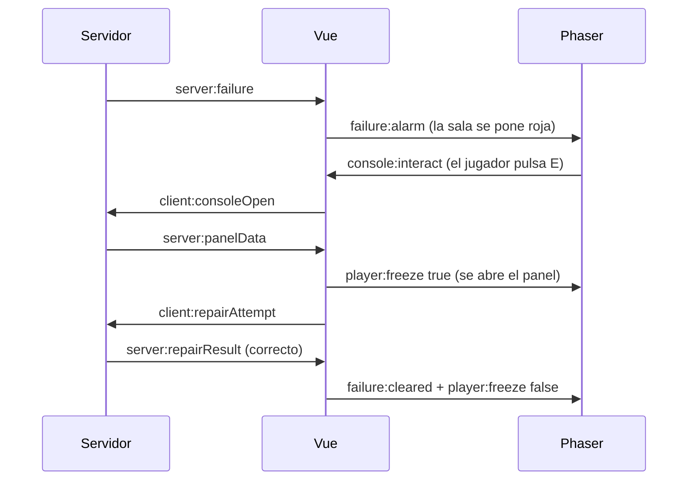
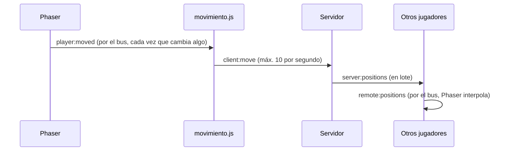

# Bus de eventos Vue ↔ Phaser · Alerta Roja

Tareas de Taiga **#16 · Documentar eventos del bus Vue ↔ Phaser**, **#61 · Bus de eventos (mitt) y documentación de los eventos** y **#62 · Envío de client:move con throttle**.

## 1. La idea

Phaser (el juego) y Vue (la web) **no se hablan directamente**. Se pasan mensajes a través de un **bus**: un objeto común donde uno *envía* un mensaje (`emit`) y el otro lo *escucha* (`on`).

```
Servidor  ⇄  movimiento.js   ⇄ ┐
Servidor  ⇄  PlazaCanvas.vue ⇄ ┴ bus  ⇄  NaveScene (Phaser)
```

- **Phaser** solo pinta el mapa y los avatares y lee el teclado.
- **Vue** habla con el servidor (Socket.IO) y guarda los datos en Pinia.
- **El bus** lleva los mensajes de un lado a otro.
- **`movimiento.js`** es el puente que envía la posición del jugador al servidor, con un límite de frecuencia.

Para el bus usamos la librería **mitt** (`npm install mitt`), que es muy pequeña y fácil de usar.

## 2. Normas

1. Phaser **no** usa el socket ni Pinia. Solo usa el bus.
2. Cada mensaje va **en un solo sentido**: de Phaser a Vue, o de Vue a Phaser.
3. Al salir de la vista de la nave hay que **limpiar** el bus (`bus.all.clear()`). Si no, al volver a entrar los mensajes llegan repetidos.
4. El envío de la posición al servidor lo hace **solo** `src/services/movimiento.js`. Ningún otro componente debe escuchar `player:moved` para enviarlo al socket: se enviaría dos veces.

---

## 3. Mensajes de Phaser → Vue

| Mensaje | Datos | Cuándo |
|---|---|---|
| `scene:ready` | — | El mapa ya está cargado |
| `player:moved` | `{ x, y, dir, anim }` | Cambia la posición, la dirección o la animación de mi avatar |
| `console:interact` | `{ consoleId }` | Pulso **E** al lado de una consola |

> `anim` vale `"idle"` (parado) o `"walk"` (andando). Cuando el jugador se detiene, Phaser debe emitir un último `player:moved` con `anim: "idle"`.
>
> Phaser emite `player:moved` cada vez que algo cambia. El límite de frecuencia (máximo 10 envíos por segundo) **no** lo aplica Phaser: lo aplica `movimiento.js` al enviarlo al servidor.

## 4. Mensajes de Vue → Phaser

| Mensaje | Datos | Cuándo |
|---|---|---|
| `game:init` | `{ myId, users }` | Al entrar: lista de jugadores para pintarlos |
| `remote:joined` | `{ id, name, color, x, y }` | Entra un jugador |
| `remote:left` | `{ id }` | Sale un jugador |
| `remote:positions` | `[{ id, x, y, dir, anim }]` | Llegan las posiciones del servidor |
| `player:freeze` | `true` / `false` | Se abre o se cierra un panel (el avatar no se puede mover) |
| `failure:alarm` | `{ roomZone }` | Hay una avería: la sala se pone roja |
| `failure:cleared` | `{ roomZone }` | La avería está reparada: la sala vuelve a la normalidad |

> El HUD, el panel de vídeo y el de tripulación **no** pasan por el bus: son componentes de Vue que leen de Pinia.

## 5. Mensajes con el servidor

Estos son los mensajes de Socket.IO relacionados con el movimiento:

| Mensaje | Sentido | Datos | Notas |
|---|---|---|---|
| `client:move` | Cliente → servidor | `{ x, y, dir, anim }` | Máximo 10 por segundo y solo si hay cambios. Se envía como *volatile* |
| `server:positions` | Servidor → cliente | `[{ id, x, y, dir, anim }]` | Por sala, en lote, con un tick de 10 a 15 Hz |

> **Pendiente de acordar:** `protocol.md` usa otros nombres para lo mismo (`player:move` y `player:moved`, uno por jugador y con un máximo de 15 Hz). Estos nombres (`client:move` y `server:positions`) son los de los criterios de la historia #60 de Taiga. Hay que dejar un solo juego de nombres en los dos documentos.
>
> El servidor sabe en qué sala está cada jugador, porque al entrar en la nave hace `socket.join(room.id)`. Por eso `client:move` no lleva `roomId`.

---

## 6. Ejemplo: reparar una avería



## 7. Ejemplo: moverse



---

## 8. Código

### `src/game/bus.js`

```js
import mitt from 'mitt'

export const bus = mitt()
```

### `src/services/movimiento.js`

Escucha `player:moved` en el bus y lo envía al servidor como `client:move`, con un máximo de 10 envíos por segundo y solo si algo ha cambiado.

Si un mensaje llega demasiado pronto, se guarda y se envía al cumplirse el intervalo. Así nunca se pierde el último (por ejemplo, el de `anim: "idle"` al pararse).

```js
import { bus } from '@/game/bus'
import { socket } from '@/services/socket'

const INTERVALO_MS = 100

let ultimoEnvio = 0
let ultimoEnviado = null
let pendiente = null
let temporizador = null

function hayCambio(a, b) {
  return !b || a.x !== b.x || a.y !== b.y || a.dir !== b.dir || a.anim !== b.anim
}

function enviar(pos) {
  if (!hayCambio(pos, ultimoEnviado)) return

  ultimoEnviado = pos
  ultimoEnvio = Date.now()

  // volatile: si un mensaje se pierde no pasa nada, llegará el siguiente
  socket.volatile.emit('client:move', pos)
}

function alMoverse(pos) {
  const espera = INTERVALO_MS - (Date.now() - ultimoEnvio)

  if (espera <= 0) {
    enviar(pos)
    return
  }

  // Demasiado pronto: nos quedamos con la posición más reciente
  pendiente = pos
  if (!temporizador) {
    temporizador = setTimeout(() => {
      temporizador = null
      if (pendiente) {
        enviar(pendiente)
        pendiente = null
      }
    }, espera)
  }
}

export function iniciarMovimiento() {
  bus.on('player:moved', alMoverse)
}

export function detenerMovimiento() {
  bus.off('player:moved', alMoverse)
  clearTimeout(temporizador)
  temporizador = null
  pendiente = null
  ultimoEnviado = null
  ultimoEnvio = 0
}
```

### `src/components/PlazaCanvas.vue`

Este componente crea el juego, recibe los mensajes del servidor y se los pasa a Phaser. También activa el envío del movimiento. Mientras no exista el mapa, `iniciarMovimiento()` y `detenerMovimiento()` se pueden llamar desde `NaveView.vue`.

```vue
<script setup>
import { onMounted, onUnmounted } from 'vue'
import Phaser from 'phaser'
import { bus } from '../game/bus'
import NaveScene from '../game/NaveScene'
import { socket } from '../services/socket'
import { iniciarMovimiento, detenerMovimiento } from '../services/movimiento'

let game = null

onMounted(() => {
  // 1. Crear el juego
  game = new Phaser.Game({
    type: Phaser.AUTO,
    parent: 'juego',
    width: 1280,
    height: 800,
    physics: { default: 'arcade' },
    scene: [NaveScene]
  })

  // 2. Phaser → servidor
  // La posición (player:moved) la envía movimiento.js, no este componente
  iniciarMovimiento()

  bus.on('console:interact', (datos) => {
    socket.emit('client:consoleOpen', datos)
  })

  // 3. Servidor → Phaser
  socket.on('server:welcome', (datos) => {
    bus.emit('game:init', { myId: datos.self.id, users: datos.users })
  })

  socket.on('server:userJoined', (datos) => {
    bus.emit('remote:joined', datos.user)
  })

  socket.on('server:userLeft', (datos) => {
    bus.emit('remote:left', { id: datos.id })
  })

  socket.on('server:positions', (lista) => {
    bus.emit('remote:positions', lista)
  })

  socket.on('server:failure', (averia) => {
    bus.emit('failure:alarm', { roomZone: averia.roomZone })
  })
})

onUnmounted(() => {
  // Limpiar todo para no tener mensajes repetidos
  detenerMovimiento()
  game.destroy(true)
  bus.all.clear()
  socket.off('server:welcome')
  socket.off('server:userJoined')
  socket.off('server:userLeft')
  socket.off('server:positions')
  socket.off('server:failure')
})
</script>

<template>
  <div id="juego"></div>
</template>
```

> **Pendiente de implementar en el servidor:** `server:welcome`, `server:userJoined` y `server:userLeft` todavía no existen en el backend (hoy solo hay eventos `lobby:*`). Hasta que se implementen, `PlazaCanvas.vue` no recibirá esos mensajes.

### `src/game/NaveScene.js`

La escena escucha los mensajes de Vue y avisa cuando el jugador cambia de posición, de dirección o de animación.

```js
import Phaser from 'phaser'
import { bus } from './bus'

export default class NaveScene extends Phaser.Scene {
  constructor () {
    super('NaveScene')
    this.otros = {}          // avatares de los demás jugadores (por id)
    this.congelado = false
    this.ultimoEstado = null // último estado que se avisó a Vue
  }

  create () {
    // ... cargar el mapa, crear this.yo, teclas, colisiones ...

    // Mensajes que llegan de Vue
    bus.on('game:init', (datos) => {
      datos.users.forEach((u) => {
        if (u.id !== datos.myId) this.crearOtro(u)
      })
    })

    bus.on('remote:joined', (u) => this.crearOtro(u))

    bus.on('remote:left', (datos) => {
      this.otros[datos.id].destroy()
      delete this.otros[datos.id]
    })

    bus.on('remote:positions', (lista) => {
      lista.forEach((p) => {
        const avatar = this.otros[p.id]
        if (avatar) avatar.setPosition(p.x, p.y)
      })
    })

    bus.on('player:freeze', (valor) => {
      this.congelado = valor
    })

    // Avisar a Vue de que el mapa ya está listo
    bus.emit('scene:ready')
  }

  update () {
    if (this.congelado) return

    // ... mover this.yo con las flechas ...

    // Avisar a Vue solo si algo ha cambiado.
    // El límite de frecuencia lo aplica services/movimiento.js, no la escena.
    const estado = {
      x: Math.round(this.yo.x),
      y: Math.round(this.yo.y),
      dir: this.direccion,
      anim: this.animacion // 'idle' o 'walk'
    }

    const u = this.ultimoEstado
    const cambio = !u || u.x !== estado.x || u.y !== estado.y ||
      u.dir !== estado.dir || u.anim !== estado.anim

    if (cambio) {
      this.ultimoEstado = estado
      bus.emit('player:moved', estado)
    }
  }

  crearOtro (u) {
    this.otros[u.id] = this.add.circle(u.x, u.y, 12, u.color)
  }
}
```

> **Mejora opcional:** en lugar de `setPosition`, se puede usar `this.tweens.add({ targets: avatar, x: p.x, y: p.y, duration: 100 })` para que los demás se muevan más suave. Es lo que pide el criterio de interpolar los avatares remotos.

---

## 9. Comprobar que funciona

### Ver los mensajes del bus

Para ver en la consola del navegador todos los mensajes del bus:

```js
bus.on('*', (nombre, datos) => console.log('[bus]', nombre, datos))
```

### Que no salgan repetidos

Entra en la nave, vuelve al hangar y entra otra vez. Cada `player:moved` debe salir **una sola vez**. Si sale repetido, falta limpiar en `onUnmounted`.

### Que el límite de frecuencia funciona

Sin el mapa, se puede simular a Phaser emitiendo muchos mensajes por segundo (solo para probar, no subirlo):

```js
let x = 0
setInterval(() => bus.emit('player:moved', { x: x++, y: 0, dir: 'right', anim: 'walk' }), 16)
```

Eso emite unos 60 mensajes por segundo. En las herramientas del navegador, pestaña Red, filtro WS, deben salir unos **10 `client:move` por segundo**, no 60.

---

## 10. Cambios

| Versión | Fecha | Cambio |
|---|---|---|
| v1 | 24/11/2026 | Primera versión |
| v2 | 27/11/2026 | Añadido `anim` a `player:moved` y `remote:positions`. El envío de `client:move` pasa a `services/movimiento.js`, con límite de 10 por segundo. Añadidos los mensajes con el servidor y el ejemplo de movimiento |

Si añadís un mensaje nuevo, apuntadlo primero en este documento.