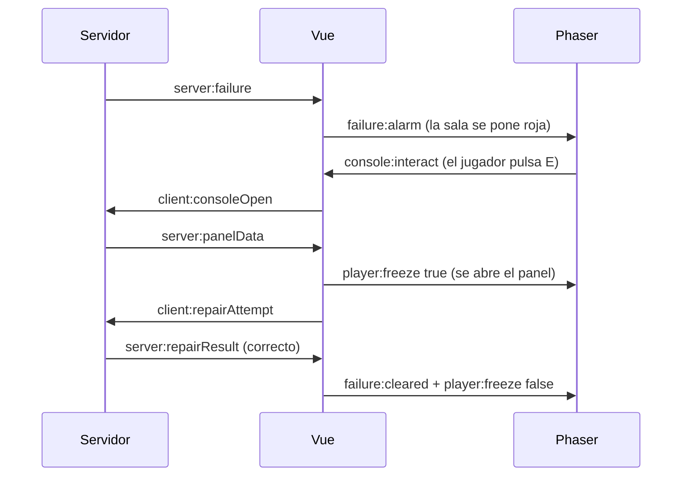

# Bus de eventos Vue ↔ Phaser · Alerta Roja

Tarea de Taiga **#16 · Documentar eventos del bus Vue ↔ Phaser**.

## 1. La idea

Phaser (el juego) y Vue (la web) **no se hablan directamente**. Se pasan mensajes a través de un **bus**: un objeto común donde uno *envía* un mensaje (`emit`) y el otro lo *escucha* (`on`).

```
Servidor  ⇄  PlazaCanvas.vue  ⇄  bus  ⇄  NaveScene (Phaser)
```

- **Phaser** solo pinta el mapa y los avatares y lee el teclado.
- **Vue** habla con el servidor (Socket.IO) y guarda los datos en Pinia.
- **El bus** lleva los mensajes de un lado a otro.

Para el bus usamos la librería **mitt** (`npm install mitt`), que es muy pequeña y fácil de usar.

## 2. Normas

1. Phaser **no** usa el socket ni Pinia. Solo usa el bus.
2. Cada mensaje va **en un solo sentido**: de Phaser a Vue, o de Vue a Phaser.
3. Al salir de la vista de la nave hay que **limpiar** el bus (`bus.all.clear()`). Si no, al volver a entrar los mensajes llegan repetidos.

---

## 3. Mensajes de Phaser → Vue

| Mensaje | Datos | Cuándo |
|---|---|---|
| `scene:ready` | — | El mapa ya está cargado |
| `player:moved` | `{ x, y, dir }` | Mi avatar se mueve (como mucho cada 100 ms) |
| `console:interact` | `{ consoleId }` | Pulso **E** al lado de una consola |

## 4. Mensajes de Vue → Phaser

| Mensaje | Datos | Cuándo |
|---|---|---|
| `game:init` | `{ myId, users }` | Al entrar: lista de jugadores para pintarlos |
| `remote:joined` | `{ id, name, color, x, y }` | Entra un jugador |
| `remote:left` | `{ id }` | Sale un jugador |
| `remote:positions` | `[{ id, x, y, dir }]` | Llegan las posiciones del servidor |
| `player:freeze` | `true` / `false` | Se abre o se cierra un panel (el avatar no se puede mover) |
| `failure:alarm` | `{ roomZone }` | Hay una avería: la sala se pone roja |
| `failure:cleared` | `{ roomZone }` | La avería está reparada: la sala vuelve a la normalidad |

> El HUD, el panel de vídeo y el de tripulación **no** pasan por el bus: son componentes de Vue que leen de Pinia.

---

## 5. Ejemplo: reparar una avería



---

## 6. Código

### `src/game/bus.js`

```js
import mitt from 'mitt'

export const bus = mitt()
```

### `src/components/PlazaCanvas.vue`

Este componente crea el juego, recibe los mensajes del servidor y se los pasa a Phaser.

```vue
<script setup>
import { onMounted, onUnmounted } from 'vue'
import Phaser from 'phaser'
import { bus } from '../game/bus'
import NaveScene from '../game/NaveScene'
import { socket } from '../services/socket'

let game = null

onMounted(() => {
  // 1. Crear el juego
  game = new Phaser.Game({
    type: Phaser.AUTO,
    parent: 'juego',
    width: 1280,
    height: 800,
    physics: { default: 'arcade' },
    scene: [NaveScene]
  })

  // 2. Phaser → servidor
  bus.on('player:moved', (pos) => {
    socket.emit('client:move', pos)
  })

  bus.on('console:interact', (datos) => {
    socket.emit('client:consoleOpen', datos)
  })

  // 3. Servidor → Phaser
  socket.on('server:welcome', (datos) => {
    bus.emit('game:init', { myId: datos.self.id, users: datos.users })
  })

  socket.on('server:userJoined', (datos) => {
    bus.emit('remote:joined', datos.user)
  })

  socket.on('server:userLeft', (datos) => {
    bus.emit('remote:left', { id: datos.id })
  })

  socket.on('server:positions', (lista) => {
    bus.emit('remote:positions', lista)
  })

  socket.on('server:failure', (averia) => {
    bus.emit('failure:alarm', { roomZone: averia.roomZone })
  })
})

onUnmounted(() => {
  // Limpiar todo para no tener mensajes repetidos
  game.destroy(true)
  bus.all.clear()
  socket.off('server:welcome')
  socket.off('server:userJoined')
  socket.off('server:userLeft')
  socket.off('server:positions')
  socket.off('server:failure')
})
</script>

<template>
  <div id="juego"></div>
</template>
```

### `src/game/NaveScene.js`

La escena escucha los mensajes de Vue y avisa cuando el jugador se mueve.

```js
import Phaser from 'phaser'
import { bus } from './bus'

export default class NaveScene extends Phaser.Scene {
  constructor () {
    super('NaveScene')
    this.otros = {}          // avatares de los demás jugadores (por id)
    this.congelado = false
    this.ultimoEnvio = 0
  }

  create () {
    // ... cargar el mapa, crear this.yo, teclas, colisiones ...

    // Mensajes que llegan de Vue
    bus.on('game:init', (datos) => {
      datos.users.forEach((u) => {
        if (u.id !== datos.myId) this.crearOtro(u)
      })
    })

    bus.on('remote:joined', (u) => this.crearOtro(u))

    bus.on('remote:left', (datos) => {
      this.otros[datos.id].destroy()
      delete this.otros[datos.id]
    })

    bus.on('remote:positions', (lista) => {
      lista.forEach((p) => {
        const avatar = this.otros[p.id]
        if (avatar) avatar.setPosition(p.x, p.y)
      })
    })

    bus.on('player:freeze', (valor) => {
      this.congelado = valor
    })

    // Avisar a Vue de que el mapa ya está listo
    bus.emit('scene:ready')
  }

  update (time) {
    if (this.congelado) return

    // ... mover this.yo con las flechas ...

    // Enviar la posición como mucho cada 100 ms
    if (time - this.ultimoEnvio > 100) {
      this.ultimoEnvio = time
      bus.emit('player:moved', {
        x: Math.round(this.yo.x),
        y: Math.round(this.yo.y),
        dir: this.direccion
      })
    }
  }

  crearOtro (u) {
    this.otros[u.id] = this.add.circle(u.x, u.y, 12, u.color)
  }
}
```

> **Mejora opcional:** en lugar de `setPosition`, se puede usar `this.tweens.add({ targets: avatar, x: p.x, y: p.y, duration: 100 })` para que los demás se muevan más suave.

---

## 7. Comprobar que funciona

Para ver en la consola del navegador todos los mensajes del bus:

```js
bus.on('*', (nombre, datos) => console.log('[bus]', nombre, datos))
```

**Prueba:** entra en la nave, vuelve al hangar y entra otra vez. Cada `player:moved` debe salir **una sola vez**. Si sale repetido, falta limpiar en `onUnmounted`.

---

## 8. Cambios

| Versión | Fecha | Cambio |
|---|---|---|
| v1 | 24/11/2026 | Primera versión |

Si añadís un mensaje nuevo, apuntadlo primero en este documento.
