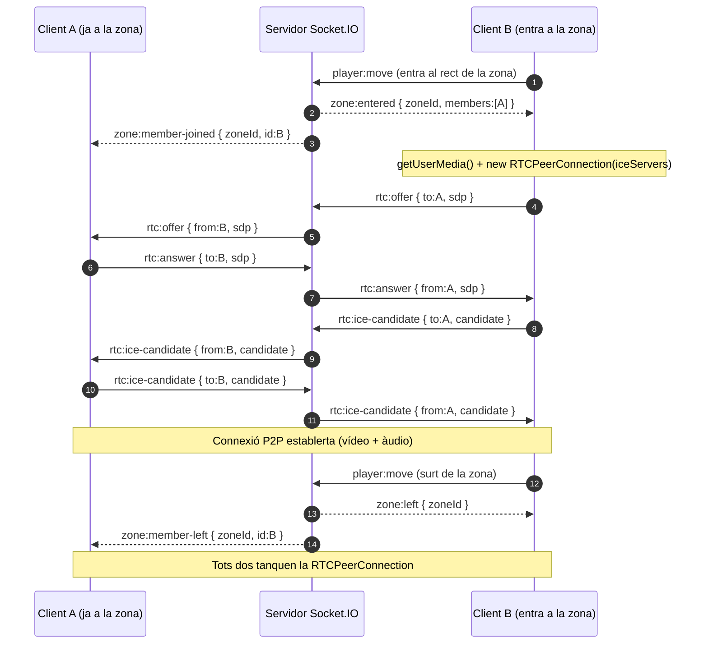

# Pixel Plaza · Protocol de comunicació (v1)

> Estat: **v1 – esborrany del kick-off**, pendent de validar amb els esbossos d'UX/UI.
> Abast: esdeveniments de Socket.IO (lobby → sala → moviment → zones → xat → interacció) i senyalització de WebRTC.
> Els noms d'esdeveniments i els *payloads* són el contracte entre client (Vue/Phaser) i servidor (Node). **Qualsevol canvi s'ha d'acordar i reflectir en aquest fitxer abans d'implementar-lo.**

---

## 1. Convencions

| Tema | Decisió |
|---|---|
| Llibreria | Socket.IO v4, espai de noms per defecte (`/`) |
| Format d'esdeveniments | `domini:acció` en minúscules i amb guions (`player:move`, `rtc:ice-candidate`) |
| Payloads | Objectes JSON. Mai valors solts. |
| Identificador de jugador | `id = socket.id` (efímer). Per a la reconnexió (stretch goal) s'afegirà un `sessionToken`. |
| Sales | Cada sala és una *room* de Socket.IO amb nom `room:<roomId>`. Les zones, `zone:<roomId>:<zoneId>`. |
| Coordenades | Píxels del món de Phaser (origen a dalt a l'esquerra). Enters. |
| Direcció (`dir`) | `"up" \| "down" \| "left" \| "right"` |
| Temps | `ts` = `Date.now()` del servidor (ms). |
| Autoritat | **El servidor és l'autoritat** sobre qui és a quina sala, zona i trucada. El client és autoritari només sobre la seva posició, però el servidor la valida. |
| Peticions amb resposta | S'usa *acknowledgement* de Socket.IO (`socket.emit(ev, payload, cb)`). |
| Esdeveniments d'alta freqüència | `player:move` s'envia amb `socket.volatile.emit` (es pot perdre sense problema). |

### 1.1 Format d'*ack*

```jsonc
// èxit
{ "ok": true,  "data": { /* depèn de l'esdeveniment */ } }
// error
{ "ok": false, "error": { "code": "ROOM_FULL", "message": "La sala està plena" } }
```

### 1.2 Codis d'error

| Codi | Significat |
|---|---|
| `INVALID_PAYLOAD` | Falten camps o tenen un tipus/valor no vàlid |
| `ROOM_NOT_FOUND` | La sala no existeix |
| `ROOM_FULL` | Sala amb `maxPlayers` assolit |
| `NAME_TAKEN` | Ja hi ha algú amb aquest nom a la sala |
| `NOT_IN_ROOM` | L'esdeveniment requereix haver fet `room:join` abans |
| `NOT_IN_ZONE` | Es demana una acció de zona però el jugador no hi és |
| `RATE_LIMITED` | Massa missatges en poc temps |
| `PEER_NOT_ALLOWED` | Senyalització RTC cap a un jugador que no és al mateix grup de trucada |
| `CALL_FULL` | El grup de trucada ha arribat al màxim (`maxCallSize`) |

---

## 2. Tipus de dades compartits

```ts
type Dir = "up" | "down" | "left" | "right";

interface Player {
  id: string;            // socket.id
  name: string;          // 2–20 caràcters
  avatarId: string;      // clau de l'sprite (p. ex. "avatar-03")
  x: number; y: number;  // posició en píxels
  dir: Dir;
  anim: "idle" | "walk";
  zoneId: string | null; // zona actual (o null)
  media: { audio: boolean; video: boolean };
}

interface RoomSummary {
  id: string;
  name: string;
  mapId: string;
  playerCount: number;
  maxPlayers: number;
}

interface WorldObject {
  id: string;            // identificador a l'arxiu del mapa
  type: string;          // "door" | "board" | "npc" | ... (segons la temàtica)
  state: Record<string, unknown>; // estat lliure per objecte
}

interface IceServer { urls: string | string[]; username?: string; credential?: string }
```

---

## 3. Esdeveniments de Socket.IO

Llegenda: **C→S** client al servidor · **S→C** servidor al client · **Sprint** és una proposta; l'equip la pot reajustar.

### 3.1 Lobby i sala

| Esdeveniment | Dir. | Payload | Resposta / Efecte | Sprint |
|---|---|---|---|---|
| `lobby:list-rooms` | C→S | `{}` | ack `data: { rooms: RoomSummary[] }` | S2 |
| `lobby:rooms-updated` | S→C | `{ rooms: RoomSummary[] }` | Difusió als que són al lobby quan canvia una sala | S2 |
| `room:join` | C→S | `{ roomId, name, avatarId }` | ack `data: { self: Player, players: Player[], objects: WorldObject[], mapId, iceServers: IceServer[], limits }` | S1 |
| `room:player-joined` | S→C | `{ player: Player }` | Difusió a la resta de la sala | S1 |
| `room:leave` | C→S | `{}` | ack `data: {}` | S1 |
| `room:player-left` | S→C | `{ id }` | Difusió a la resta de la sala. En desconnexió també s'emet. | S1 |
| `player:update` | C→S | `{ name?, avatarId? , media?: {audio, video} }` | ack amb el `Player` actualitzat | S2 |
| `player:updated` | S→C | `{ id, name?, avatarId?, media? }` | Difusió a la sala | S2 |

**Notes**

- Al ser el primer cop, el `room:join` ja retorna l'estat complet (`players`, `objects`): no cal cap esdeveniment `room:state` addicional.
- `limits` = `{ maxCallSize: 6, chatMaxLength: 280, moveRateHz: 15 }`, perquè client i servidor comparteixin les constants.
- En MVP1 pot existir només una sala fixa (`roomId: "plaza"`) i `lobby:*` es pot ometre.

### 3.2 Moviment

| Esdeveniment | Dir. | Payload | Efecte | Sprint |
|---|---|---|---|---|
| `player:move` | C→S (volàtil) | `{ x, y, dir, anim }` | El servidor valida i actualitza l'estat | S1 |
| `player:moved` | S→C | `{ id, x, y, dir, anim, ts }` | Difusió a la sala, **excepte** l'emissor | S1 |

**Regles**

- El client emet `player:move` com a màxim a **15 Hz** i només si la posició o l'animació han canviat. Cal enviar un últim missatge amb `anim: "idle"` en aturar-se.
- Els clients remots **interpolen** entre posicions rebudes (no es teletransporta l'sprite).
- Validació al servidor: dins dels límits del mapa, velocitat màxima (≈ `speed * Δt * 1.5`), no travessar col·lisions fixes si es té el mapa carregat. Si és invàlid, el servidor ignora el missatge i envia `player:correct`.

| Esdeveniment | Dir. | Payload | Efecte | Sprint |
|---|---|---|---|---|
| `player:correct` | S→C | `{ x, y }` | Força la posició del jugador local (anti-trampa / re-sincronització) | S2 |

### 3.3 Zones i proximitat

Les zones es defineixen a l'arxiu del mapa (`shared/maps/<mapId>.json`), que **llegeixen tant client com servidor**:

```jsonc
{ "id": "meeting-1", "type": "call", "rect": { "x": 320, "y": 160, "w": 192, "h": 128 }, "name": "Sala de reunions" }
```

Tipus de zona: `call` (tothom dins és al mateix grup de videotrucada), `chat` (només xat de zona), `info` (només UI, sense comunicació).

El servidor calcula la zona de cada jugador a partir de la seva posició a cada `player:move` i emet només quan canvia.

| Esdeveniment | Dir. | Payload | Efecte | Sprint |
|---|---|---|---|---|
| `zone:entered` | S→C | `{ zoneId, type, members: string[] }` | Al jugador que entra; `members` = ids que ja hi eren | S2 |
| `zone:left` | S→C | `{ zoneId }` | Al jugador que surt | S2 |
| `zone:member-joined` | S→C | `{ zoneId, id }` | Als que ja hi eren | S2 |
| `zone:member-left` | S→C | `{ zoneId, id }` | Als que es queden | S2 |
| `proximity:update` | S→C | `{ near: { id: string, distance: number }[] }` | Només quan canvia el conjunt de jugadors a prop (radi `PROXIMITY_RADIUS`, p. ex. 96 px) | S3 |

Els esdeveniments de zona són el **disparador** de la videotrucada (veure §4). La proximitat (`proximity:update`) és opcional i s'usa per al xat de proximitat o per a trucades per veïnatge.

### 3.4 Xat

| Esdeveniment | Dir. | Payload | Resposta / Efecte | Sprint |
|---|---|---|---|---|
| `chat:send` | C→S | `{ scope: "room" \| "zone" \| "proximity", text }` | ack `data: { id }` | S2 |
| `chat:message` | S→C | `{ id, scope, from: { id, name }, text, ts }` | Es lliura segons l'`scope` | S2 |

- `room` → tota la sala · `zone` → membres de la zona actual (si no és en cap, `NOT_IN_ZONE`) · `proximity` → jugadors a prop (S3).
- El servidor **valida** (1–280 caràcters, `trim`), **escapa/neteja** el text i aplica un límit de **5 missatges / 5 s** per jugador (`RATE_LIMITED`).
- El client mostra el text com a text pla (mai `v-html`).

### 3.5 Interacció amb objectes

| Esdeveniment | Dir. | Payload | Resposta / Efecte | Sprint |
|---|---|---|---|---|
| `object:interact` | C→S | `{ objectId, action?: string, data?: object }` | ack `data: { state }`. El servidor comprova que el jugador és a prop (≤ `INTERACT_RADIUS`) | S2 |
| `object:state` | S→C | `{ objectId, state, by: string, ts }` | Difusió a la sala quan l'estat canvia (p. ex. una porta s'obre) | S2 |

> L'estat inicial dels objectes viatja a `room:join`. Els tipus d'objecte i les `action` concretes les defineix cada temàtica; aquí només es fixa el sobre.

### 3.6 Estat dels mitjans

| Esdeveniment | Dir. | Payload | Efecte | Sprint |
|---|---|---|---|---|
| `media:state` | C→S | `{ audio: boolean, video: boolean }` | Actualitza `player.media` | S3 |
| `media:state-changed` | S→C | `{ id, audio, video }` | Difusió a la sala (per mostrar icones de micro/càmera mutejats) | S3 |

---

## 4. Senyalització WebRTC

Socket.IO només **transporta** la senyalització; el vídeo i l'àudio viatgen *peer-to-peer* (o via TURN).

### 4.1 Topologia i grups de trucada

- **Malla (*mesh*)**: cada membre del grup té una `RTCPeerConnection` amb tots els altres. Màxim **`maxCallSize` = 6** persones per grup (si no, `CALL_FULL`).
- **Grup de trucada** = els membres d'una zona de tipus `call`. (En S3, opcionalment, també un grup per proximitat.)
- **Qui inicia?** Per evitar *glare* (dues ofertes creuades), **sempre ofereix qui acaba d'entrar** al grup: en rebre `zone:entered` amb `members`, crea una oferta per a cada `id` de `members`. Els que ja hi eren només esperen `rtc:offer`.

### 4.2 Esdeveniments

| Esdeveniment | Dir. | Payload C→S | Payload S→C | Notes |
|---|---|---|---|---|
| `rtc:offer` | C→S→C | `{ to, sdp }` | `{ from, sdp }` | `sdp` = `RTCSessionDescriptionInit` |
| `rtc:answer` | C→S→C | `{ to, sdp }` | `{ from, sdp }` | |
| `rtc:ice-candidate` | C→S→C | `{ to, candidate }` | `{ from, candidate }` | `candidate` = `RTCIceCandidateInit`; es pot enviar `null` per marcar el final |
| `rtc:hangup` | C→S→C | `{ to }` | `{ from }` | Tancament explícit d'una connexió amb un peer |
| `rtc:error` | S→C | — | `{ code, to?, message }` | P. ex. `PEER_NOT_ALLOWED`, `CALL_FULL` |

**El servidor només fa de repetidor**, però abans de reenviar comprova que:

1. L'emissor i el destinatari són a la mateixa sala.
2. Tots dos són al mateix grup de trucada (mateixa zona `call`).

Si no, respon `rtc:error` amb `PEER_NOT_ALLOWED` i no reenvia res. El servidor **no inspecciona ni emmagatzema** l'SDP.

### 4.3 Servidors ICE (STUN/TURN)

- Es lliuren al client dins l'*ack* de `room:join` (`iceServers`), no pas codificats al front.
- STUN públic + **TURN propi (coturn)** al `docker-compose`, amb credencials **temporals** generades pel servidor (mode `use-auth-secret`, usuari = `timestamp:id`, caducitat d'1 h).

### 4.4 Cicle de vida d'una trucada



### 4.5 Regles de tancament

Un client tanca la `RTCPeerConnection` amb un peer (i elimina el seu `<video>`) quan:

- rep `zone:member-left` d'aquell peer, o `zone:left` (tanca totes);
- rep `room:player-left` d'aquell peer (desconnexió brusca);
- rep `rtc:hangup` d'aquell peer;
- `connectionState` passa a `failed` o `closed`.

Si el client **local** surt de la zona, envia `rtc:hangup` a cadascun dels peers abans de tancar.

---

## 5. Cicle de vida de la connexió

1. `connect` → el client **no** és encara a cap sala. Només pot emetre `lobby:*` i `room:join`.
2. `room:join` (ack OK) → el jugador queda registrat; la resta rep `room:player-joined`.
3. Joc normal: `player:move`, `chat:*`, `object:*`, zones, RTC…
4. `disconnect` (o `room:leave`) → el servidor:
   - elimina el jugador de la sala i de la seva zona,
   - emet `room:player-left` i `zone:member-left`,
   - allibera les seves dades.

**Reconnexió (stretch goal, no inclosa a v1):** el servidor entregarà un `sessionToken` a `room:join`; en reconnectar, el client emetria `session:resume { token }` i el servidor mantindria el jugador reservat durant 30 s.

---

## 6. Seguretat i robustesa

- **Validar tot al servidor**: tipus, longituds, rangs numèrics i existència de `roomId`, `objectId`, `to`. Un payload invàlid → `INVALID_PAYLOAD` i es descarta.
- **Mai confiar en `from`**: el servidor posa `from`/`id` amb el `socket.id` real; ignora qualsevol valor equivalent que enviï el client.
- **Rate limiting** per esdeveniment (moviment, xat, interacció, RTC).
- **CORS** restringit a l'origen del frontend.
- El text de xat i els noms es renderitzen sempre com a **text pla** (prevenció d'XSS).

---

## 7. Integració amb el client (resum)

- Un únic mòdul `services/socket.js` crea la connexió i **tradueix els esdeveniments rebuts** en accions dels *stores* de Pinia. L'enunciat n'exigeix com a mínim tres: l'usuari actual (`useUserStore`), la llista d'usuaris presents (`usePlayersStore`) i l'estat de les trucades (`useCallStore`). A més, l'equip hi afegeix `useChatStore` (xat) i `useGlobalStore` (vista actual, connexió, avisos i dades del resum). `useWorldStore` (estat dels objectes) és opcional i només si la temàtica el necessita.
- Phaser **no parla directament amb Socket.IO**: emet i escolta a través d'un bus d'esdeveniments / el *store* (detall a `docs/arquitectura.md`).
- `useCallStore` gestiona les `RTCPeerConnection` i reacciona a `zone:*` i `rtc:*`.

| Esdeveniment rebut | Store que l'escolta |
|---|---|
| ack de `room:join` (`self`), `player:correct` | `user` |
| `room:*`, `player:moved`, `player:updated`, `media:state-changed` | `players` |
| `zone:*`, `proximity:update`, `rtc:*` | `call` |
| `chat:message` | `chat` |
| `connect`, `disconnect` | `global` |
| `object:state` | `world` (opcional) |

---

## 8. Resum per sprint (proposta)

| Sprint | Esdeveniments que han de funcionar |
|---|---|
| **S1 – Entrar i moure's** | `room:join`, `room:player-joined`, `room:player-left`, `room:leave`, `player:move`, `player:moved` |
| **S2 – Trobar-se i interactuar** | `zone:*`, `chat:send`/`chat:message`, `object:interact`/`object:state`, `player:update`/`updated`, `player:correct`, `lobby:*` (si hi ha sales múltiples) |
| **S3 – Videotrucada** | `rtc:offer`, `rtc:answer`, `rtc:ice-candidate`, `rtc:hangup`, `rtc:error`, `media:state`/`state-changed`, `proximity:update` (opcional) |

---

## 9. Preguntes obertes (per a la sessió de validació)

1. La temàtica concreta, defineix quins `type` d'objecte i quines `action` necessitem a `object:interact`?
2. Ens cal el `lobby` i les sales múltiples abans de l'S3, o ho deixem com a *stretch goal*?
3. Videotrucada **per zona**, **per proximitat** o **les dues**? (A v1 és per zona.)
4. Es manté el límit de 6 persones per grup amb malla? Si cal més, caldrà un SFU (fora d'abast).
5. Pregunta clau del kick-off: **la informació d'aquest protocol és suficient per pintar totes les pantalles i el mapa dels esbossos?** Registrar aquí els buits que es detectin:
   - [ ] …

---

## 10. Registre de canvis

| Versió | Data | Canvis |
|---|---|---|
| v1 | 2026-11-24 | Primera versió (kick-off) |