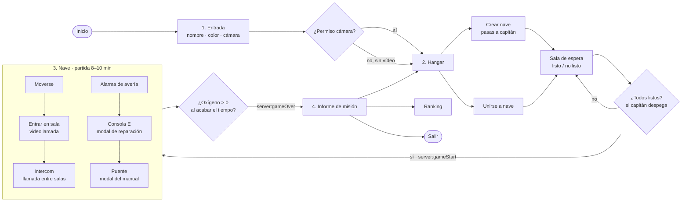
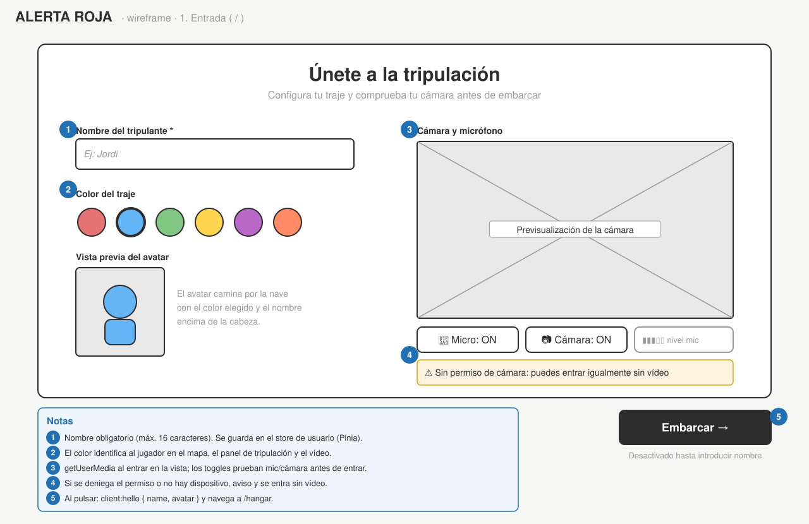
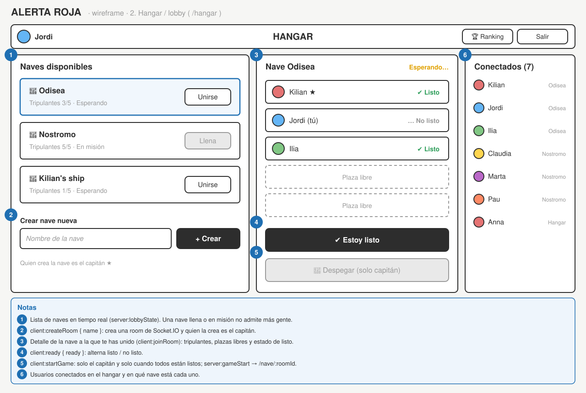
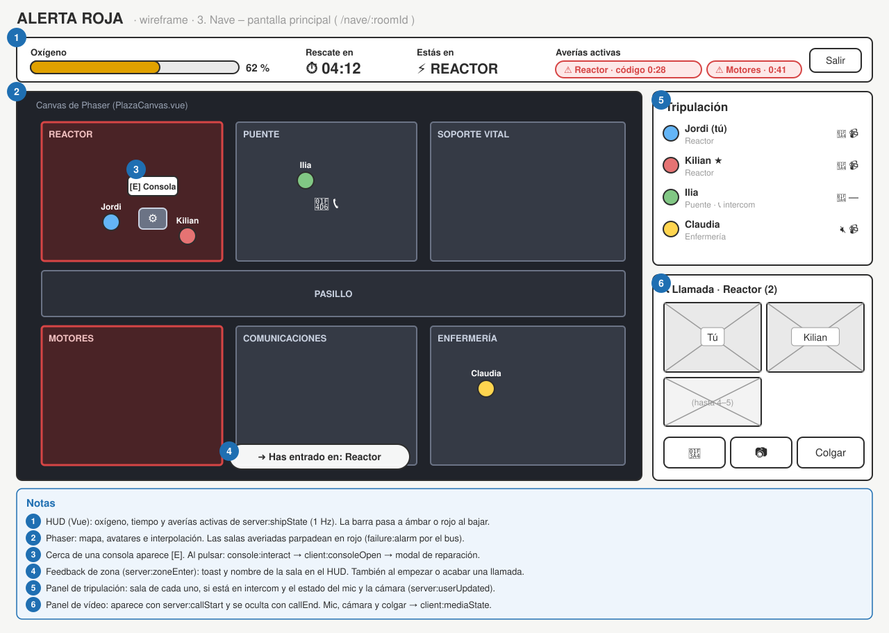
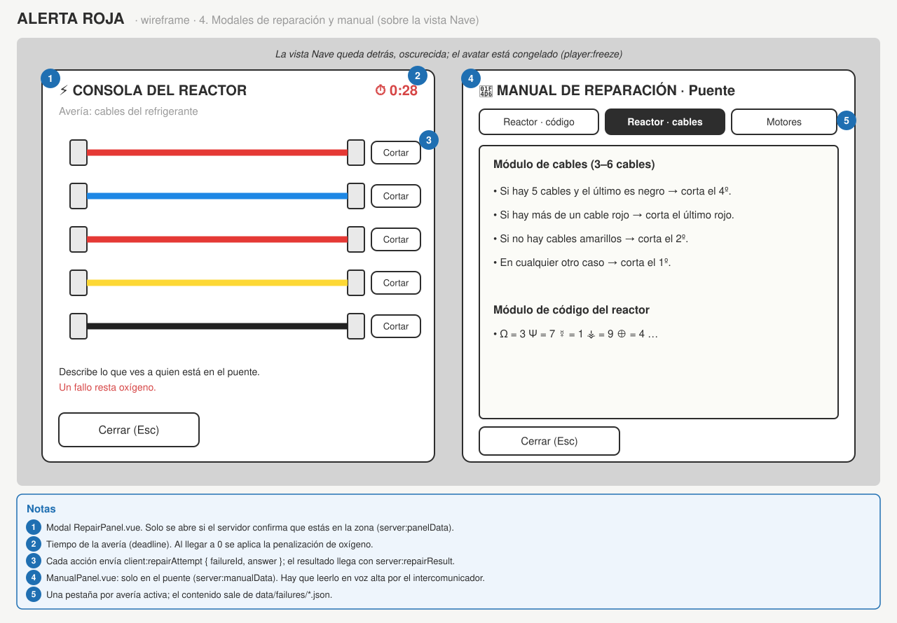
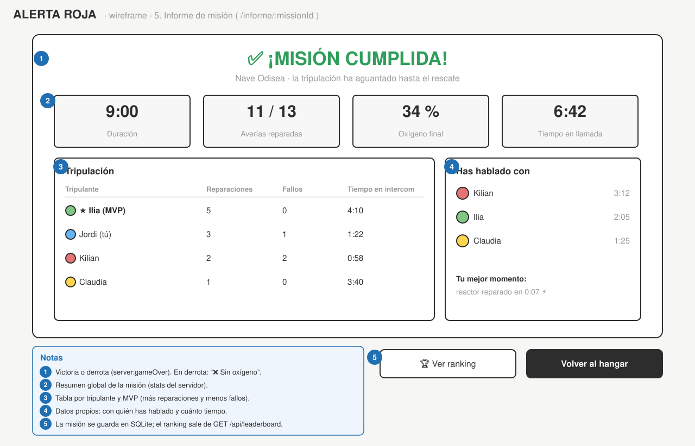
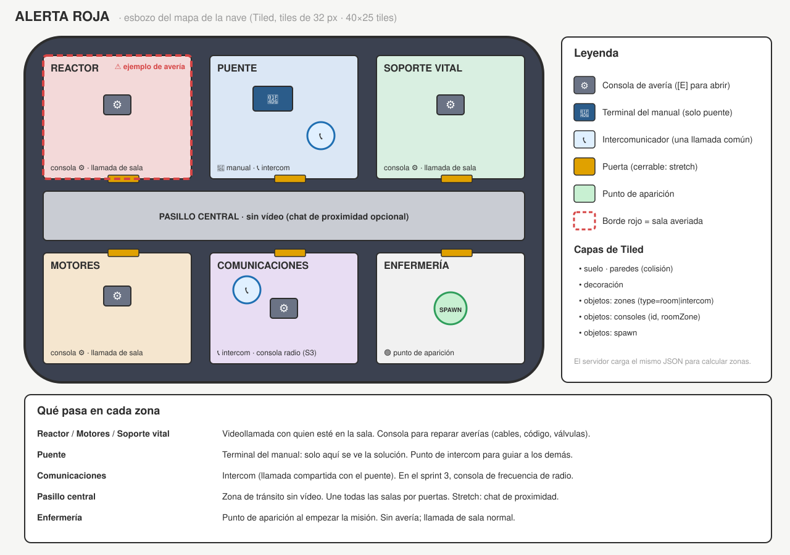

# Diseño UX/UI · Alerta Roja

Entregable de la historia de Taiga **#6 · [Kick-off] Diseño UX/UI (flujo, wireframes y mapa)**.

| Tarea de Taiga | Fichero |
|---|---|
| Diagrama de flujo de usuario | [`flujo-usuario.svg`](flujo-usuario.svg) y el diagrama Mermaid de abajo |
| Wireframe de Entrada | [`wireframe-1-entrada.svg`](wireframe-1-entrada.svg) |
| Wireframe de Hangar (lobby) | [`wireframe-2-hangar.svg`](wireframe-2-hangar.svg) |
| Wireframe de Nave (mapa + HUD + vídeo + tripulación) | [`wireframe-3-nave.svg`](wireframe-3-nave.svg) y [`wireframe-4-reparacion-manual.svg`](wireframe-4-reparacion-manual.svg) (modals) |
| Wireframe de Informe de misión | [`wireframe-5-informe.svg`](wireframe-5-informe.svg) |
| Esbozo del mapa de la nave con zonas | [`mapa-nave.svg`](mapa-nave.svg) |

Los números azules de cada wireframe remiten a las notas de la misma imagen, que indican qué evento de Socket.IO alimenta cada elemento.

---

## 1. Flujo de usuario

Si se sale en cualquier momento se emite `server:userLeft` y el avatar desaparece para el resto.

---

## 2. Pantallas

### 1 · Entrada (`/`)

- **Información:** nombre, color del traje, vista previa del avatar y de la cámara, y aviso si no hay permiso.
- **Acciones:** escribir el nombre, elegir color, probar el micro y la cámara, y pulsar **Embarcar**.
- **Eventos:** `client:hello { name, avatar }`.

### 2 · Hangar (`/hangar`)

- **Información:** naves (tripulantes y estado), tripulantes de tu nave con su estado de listo, y usuarios conectados.
- **Acciones:** crear nave, unirse, marcarse como listo, **Despegar** (solo el capitán), ver el ranking y salir.
- **Eventos:** `server:lobbyState`, `client:createRoom`, `client:joinRoom`, `client:ready`, `client:startGame` y `server:gameStart`.

### 3 · Nave (`/nave/:roomId`)

- **Información:** HUD (oxígeno, tiempo, sala actual, averías activas), mapa de Phaser con todos los avatares, panel de tripulación y panel de vídeo.
- **Acciones:** moverse, abrir una consola con **E**, silenciar el micro, apagar la cámara, colgar y salir.
- **Feedback:** sala averiada en rojo con alarma, toast al entrar en una sala y aviso al empezar o acabar una llamada.
- **Eventos:** `client:move`, `server:positions`, `server:zoneEnter`/`server:zoneLeave`, `server:callStart`/`server:callEnd`, `server:shipState`, `server:failure`, `client:mediaState` y `server:userUpdated`.

### 3b · Modales de reparación y manual

- **Reparación:** solo dentro de la sala averiada. Muestra el panel (cables, símbolos, etc.) y el tiempo restante.
- **Manual:** solo en el puente. Tiene una pestaña por avería activa con las reglas para resolverla.
- **Eventos:** `client:consoleOpen` y `server:panelData`, `client:manualOpen` y `server:manualData`, `client:repairAttempt` y `server:repairResult`.

### 4 · Informe de misión (`/informe/:missionId`)

- **Información:** victoria o derrota, duración, averías reparadas, oxígeno final, tabla por tripulante con el MVP, y con quién has hablado.
- **Acciones:** ver el ranking y volver al hangar.
- **Eventos y API:** `server:gameOver` y `GET /api/leaderboard`.

---

## 3. Mapa de la nave

| Zona | Qué pasa |
|---|---|
| Reactor / Motores / Soporte vital | Videollamada de la sala y consola de avería |
| Puente | Terminal del manual (solo aquí) e intercom |
| Comunicaciones | Intercom; consola de radio en el sprint 3 |
| Pasillo central | Tránsito sin vídeo (stretch: chat de proximidad) |
| Enfermería | Punto de aparición |

**Capas de Tiled:** suelo, paredes (colisión), decoración y objetos (`zones` con `type=room|intercom`, `consoles` con `id` y `roomZone`, y `spawn`). El servidor carga el mismo JSON para calcular en qué zona está cada jugador.
